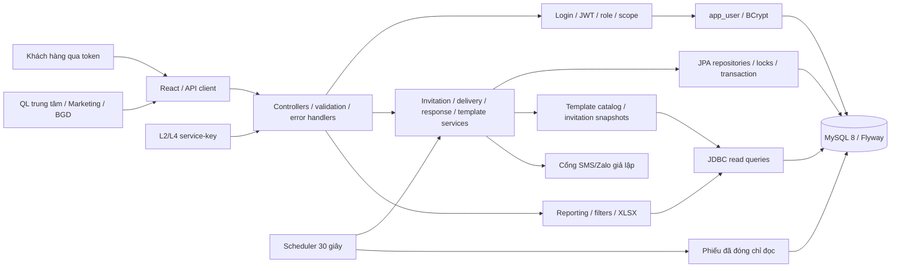

# Kiến trúc đã hiện thực – Smart CRM L8

Tiếp nối modular monolith BT1. HTTP được tiếp nhận ở controller/filter/advice, nghiệp vụ tại service, dữ liệu qua JPA/JDBC và MySQL. Trạng thái kiểm thử từng phần được ghi riêng trong báo cáo, sơ đồ không thay bằng chứng chạy.

- UC01/02: mỗi ticket một invitation; create/check closed/unique; delivery lưu attempts/trạng thái, scheduler thử lại sau 5 phút.
- UC03: khóa invitation, kiểm token/expiry/response, insert survey_response và đổi trạng thái trong transaction; UNIQUE ticket bảo vệ cuối; phản hồi không có edit/delete API.
- UC04: nhắc sau 72 giờ cùng token tối đa một lần, còn hạn/chưa trả lời.
- UC05–09: lọc/phạm vi đúng role, query database, masking trước response/XLSX; tỷ lệ/CSAT từ phản hồi thật.
- Auth bổ sung `/api/auth/login`, `/api/auth/me`; metadata hỗ trợ bộ lọc là API phụ, không thay 9 endpoint nghiệp vụ của BT1.
- V1/V2 được giữ nguyên; V3–V6 là phần bổ sung. V5 lưu retry nhắc riêng, `reminded_at` chỉ ghi thành công; giữ một reminder thành công dù có lỗi gateway trước đó. V6 bổ sung mẫu khảo sát, nội dung snapshot ở lời mời và dấu hủy để CRUD lời mời chưa gửi không cho phép phát hành lại token. Ticket/customer/trung tâm/KTV do L2/L4 sở hữu; L8 không thêm CRUD các bảng đó. `device` chứa nhãn tham chiếu thiếu chứ không tự suy ra tên sản phẩm.

Giới hạn: cổng tin nhắn là giả lập theo A02; nguồn sự kiện đóng phiếu dùng polling khi chạy độc lập; tên tham chiếu thật phải tích hợp L2/L4. S1 đã có CRUD invitation theo vòng đời và CRUD template trong mã/test; chờ GV xác nhận cách chấm học thuật. Các ranh giới lớp cần tiếp tục đối chiếu S2 bằng kiểm tra source khi nghiệm thu cuối.
