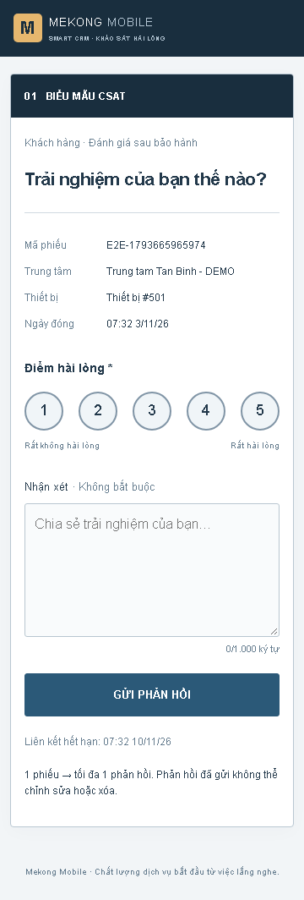
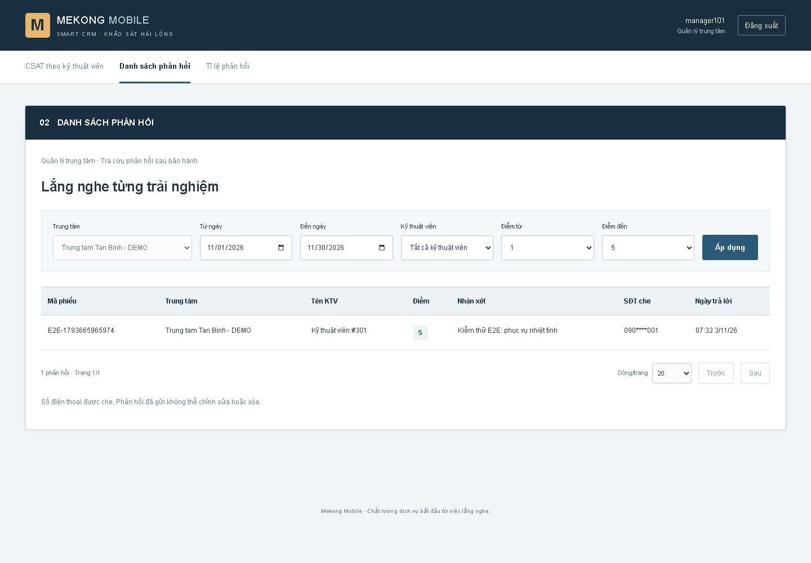
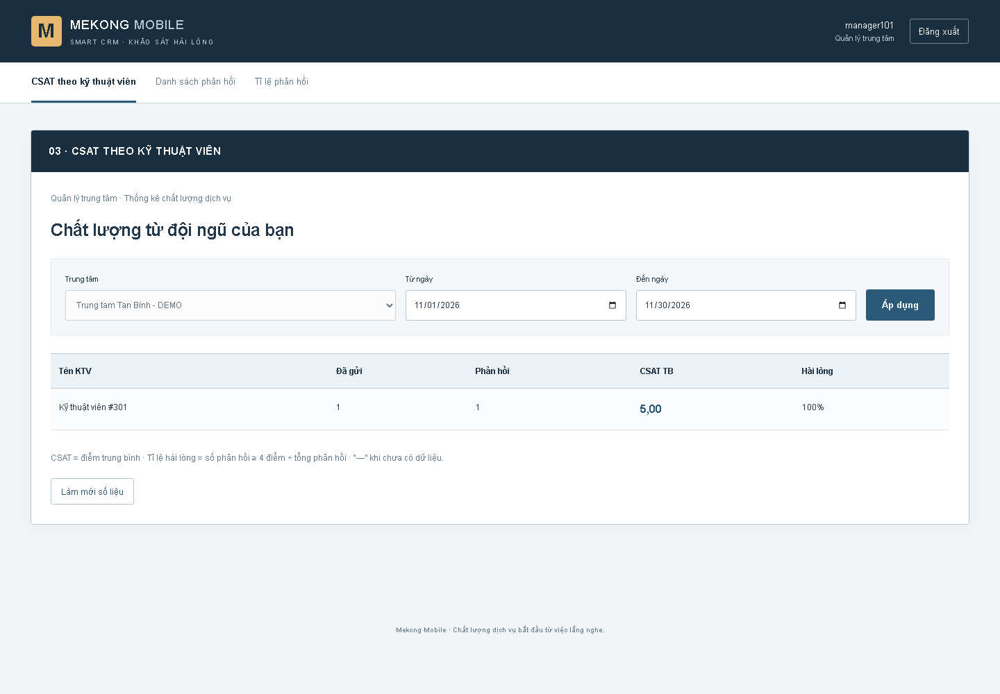
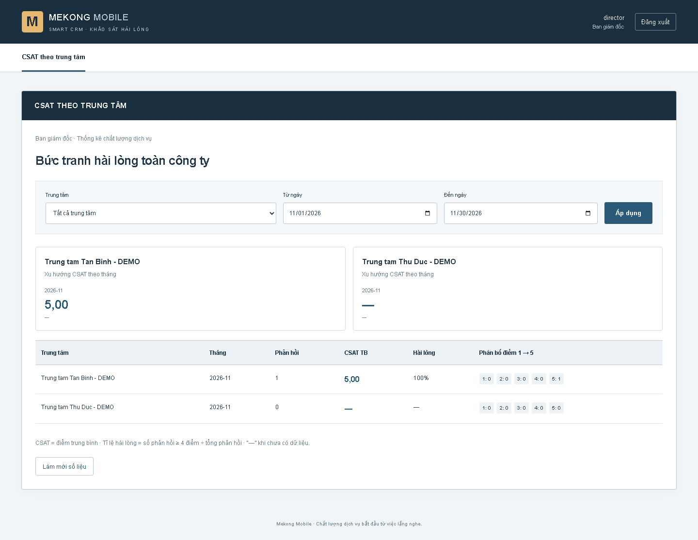
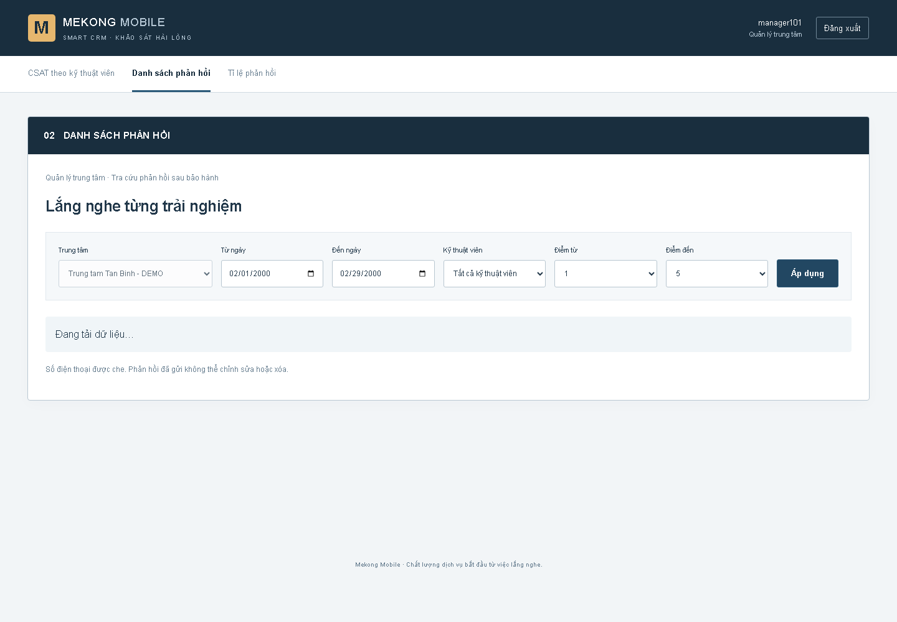
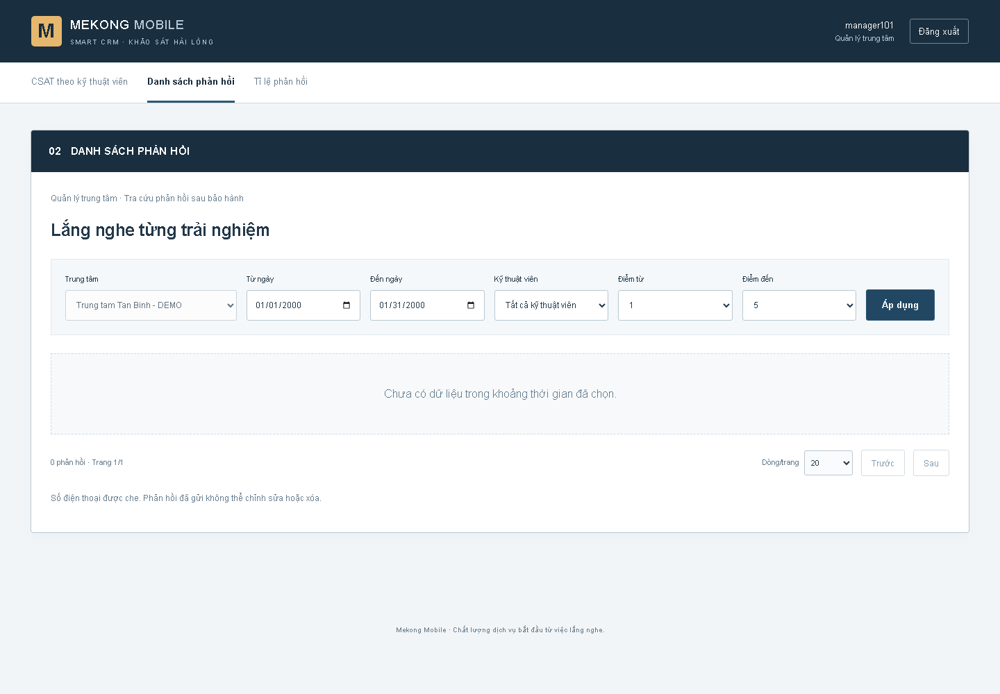
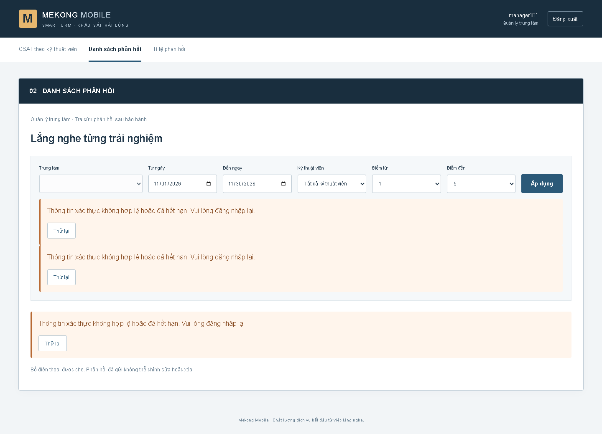

# BÁO CÁO BÀI TẬP 2

## Smart CRM – Mekong Mobile

### Luồng L8 · Khảo sát hài lòng CSAT sau bảo hành

| Thông tin | Nội dung |
|---|---|
| Sinh viên | Võ Nguyễn Thành Nhân |
| MSSV | 2374802010360 |
| Lớp | 261_71ITGR40203_05 |
| Track | SE – Software Engineering |
| Học phần | Chuyên đề tốt nghiệp 1 · HK1 năm học 2026–2027 |
| Ngày cập nhật | 12/11/2026 |
| Remote cấu hình trong Git | [github.com/nhan231105/cdtn1-05](https://github.com/nhan231105/cdtn1-05) |
| Branch thực hiện | feat/bt2-setup |
| Tag nộp v0.2 | Đối chiếu trạng thái Git cuối trước khi xác nhận |

Phân hệ tiếp nối thiết kế BT1 trên cùng repository Spring Boot/React/MySQL. Khi phiếu bảo hành đã đóng, L8 tạo lời mời, gửi qua SMS/Zalo giả lập, thu một phản hồi CSAT bất biến và cung cấp tra cứu/thống kê/Excel theo vai trò. Không có edit/delete phản hồi hoặc CRUD dữ liệu L2/L4 chỉ để đạt rubric.

**Kết quả cập nhật 12/11:** 54 backend tests PASS (0 fail/error/skip), 18 frontend tests PASS, production build PASS; browser E2E/API checks chạy trên MySQL test mới. Backend áp dụng V1–V6 trên MySQL 8.0.46 tạm cổng 3307. Đo local: NFR01 p95 46 ms/100 client, NFR02 p95 362 ms/50 client, NFR03 p95 75/41/71 ms trên 10.000 phản hồi, NFR05 1/100 POST đồng thời tạo phản hồi và NFR06 500/500 gửi qua gateway giả lập trong 7,012 giây. Chi tiết và giới hạn: [bảng xác minh](../verification-2026-11-12.md). Không sửa/xóa database đang sử dụng.

**Giới hạn công khai:** S1 có CRUD lời mời theo vòng đời và CRUD mẫu khảo sát; cách tính điểm rubric vẫn **chờ xác nhận học thuật**. NFR01/02 dùng MockMvc, NFR03 dùng loopback/MySQL test, không đại diện mạng 4G hoặc máy production. NFR04 chưa kiểm nhiều instance; NFR07 chưa thử với 5 người thật. SMS/Zalo vẫn giả lập; file hướng dẫn `Codex_SmartCRM_L8_BT2_HoanThien.md` không tìm thấy. Không suy rộng kết quả test cục bộ thành nghiệm thu production.

Nguồn PDF: `docs/reports/bt2-implementation-report.md`; xuất bằng `scripts/render-report.mjs`. PDF/DOCX người dùng có trước được giữ nguyên.

<!-- page -->

## 1. Phạm vi và truy vết toàn bộ use case

Đối chiếu SRS, API Contract 9 endpoint, Drawio 7 actor/9 UC, wireframe 3 màn, BT1/BT2 và đề/học liệu buổi 7–12. UC04 là nền, không có API công khai. SRS US8 được BT1 gộp thành US2 mở rộng; chức năng vẫn giữ.

| UC / US / FR / mức | API và frontend | Source / DB / test tương ứng | Hiện tại |
|---|---|---|---|
| UC01 / US2 / FR01–02 / MUST | EP1 POST survey-invitations; hệ thống | InvitationService; V1 unique; unit5, close-event concurrent, scheduler tick2 | DONE |
| UC02 / US2 / FR03 / MUST | EP2 POST invitations/{id}/send; hệ thống | DeliveryService/Gateway; V4 last_attempt; Flow send/failure/retry; E2E API | DONE |
| UC03 / US1 / FR04–05 / MUST | EP3 GET surveys/{token}; EP4 POST .../responses; form CSAT | ResponseService/Repository; V1 unique/TX; rollback/concurrent/input; E2E360px | DONE |
| UC04 / US8 hoặc US2 mở rộng / FR11 / COULD | Scheduler; không API/UI công khai | JobRepository+Delivery; V5 reminder; success/failure/once/retry | DONE |
| UC05 / US6 / FR08,12 / SHOULD | EP7 GET survey-responses; danh sách | ReportingService/Repository; filters/page/mask; integration+UI+E2E | DONE |
| UC06 / US3 / FR06,12 / MUST | EP5 GET stats/by-technician; màn KTV | MySQL aggregate/V3 labels; null/AVG/rate/scope integration; E2E | DONE |
| UC07 / US4 / FR07,12 / SHOULD | EP6 GET stats/by-center; trung tâm | Group month/distribution/trend; integration+E2E director | DONE |
| UC08 / US5 / FR09 / SHOULD | EP8 GET responses/export; Marketing | XLSX cùng filters, phone che, ≤10.000; Workbook/Reporting+E2E | DONE |
| UC09 / US7 / FR10 / COULD | EP9 GET stats/response-rate; tỷ lệ | Cohort sent-month; ratio 2/3→0.67 integration+E2E | DONE |

Mọi endpoint nghiệp vụ dưới `/api/`; đường dẫn rút gọn theo API Contract. API phụ auth/login, auth/me và metadata centers/technicians hỗ trợ đăng nhập/bộ lọc, không thay 9 endpoint nghiệp vụ.

FR12: EP1/2 service-key; EP3/4 public token; EP5/9 chỉ QL_TRUNG_TAM đúng center; EP6 chỉ BAN_GIAM_DOC; EP7 manager/marketing; EP8 chỉ marketing. BCrypt/JWT kiểm chữ ký/issuer/expiry, đối chiếu user enabled trong MySQL. Full role matrix qua servlet đã pass.

DONE là chức năng có source và test tương ứng, không đồng nghĩa mọi NFR tải đã đạt. Chi tiết baseline/current: [ma trận](../bt2-gap-analysis.md).

<!-- page -->

## 2. Kiến trúc thực tế và quy tắc nghiệp vụ

```text
React → API client → Controller / validation / error handler
                 → Service (business code, không HTTP/SQL)
                 → JPA/JDBC Repository → MySQL8 / Flyway
Scheduler → JobRepository (đọc L2/L4) → Invitation/Delivery
AuthService → UserRepository; Delivery → Gateway giả lập
```

SQL đã tách vào repositories, gồm scheduler; HTTP/status ở controller/filter/advice. Token SecureRandom 256bit/43ký tự base64url. Transaction khóa invitation, kiểm DA_GUI/chưa trả lời/còn hạn, insert response và đổi DA_PHAN_HOI cùng giao dịch. UNIQUE(ticket_id) bảo vệ cuối; không API sửa/xóa response.

| Quy tắc | Hiện thực và lý do |
|---|---|
| QT10, FR01–02 | Phiếu chỉ DA_DONG; unique invitation/ticket; concurrent close-event không tạo trùng |
| FR03, QT02 | SMS/ZALO, phone10số đầu0; GUI_LOI commit dù trả422/502; attempts≤3, giãn≥5phút |
| FR05, KS06 | Score integer1–5; comment≤1.000, trim/bỏHTML; response+status TX; rollback lỗi DB, duplicate409 |
| FR11, KS05 | Sau72h, cùng token, một reminder thành công; lỗi retry≤3/5phút metadata riêng; giữ sent_at |
| QT14/15 | User role/center từ MySQL; scope manager ở service; phone che ở JSON/Excel mọi vai trò |
| KS01–03 | AVG(score)2chữ số, empty→null; satisfied score≥4; response-rate cùng cohort đã gửi trong tháng |

| Migration | Nội dung / bảo toàn |
|---|---|
| V1/V2 đã có | Giữ nguyên schema/seed/checksum; không replay seed hoặc reset dữ liệu |
| V3 mới | Technician_name nullable, device label #ID, app_user BCrypt/role/center; bootstrap opt-in chỉ thêm user thiếu |
| V4 mới | last_attempt_at cho retry qua restart; giữ sent_at gửi thành công |
| V5 mới | reminder_attempts/last_reminder_attempt_at; reminded_at chỉ khi nhắc thành công |
| V6 mới | Mẫu khảo sát tối đa một mẫu hoạt động; snapshot title/intro trên lời mời; dấu hủy chặn phát hành lại cho ticket đã xóa lời mời chưa gửi |

S1 bổ sung CRUD mẫu khảo sát cho Marketing và CRUD lời mời có điều kiện: đọc danh sách/chi tiết, đổi kênh trước khi gửi, xóa vật lý khi chưa gửi/chưa có phản hồi. Dấu hủy giữ nguyên quy tắc không phát hành lại token cho cùng ticket. Không có API sửa/xóa phản hồi.

Polling30giây là adapter chỉ đọc thay event L2/L4 ở bản độc lập. Tên thiết bị/KTV thiếu hiển thị #ID rõ; cả ticket mới chưa có device record cũng có fallback, không tự suy ra tên sản phẩm. Masking theo API chặt hơn ngoại lệ SRS. Tỷ lệ dùng cohort để tử/mẫu cùng tập và không vượt1. A03–A06 vẫn ghi chờ GV theo hồ sơ gốc.

Mỗi thay đổi gì/vì sao/ảnh hưởng: [thay đổi thiết kế](../thay-doi-thiet-ke.md); [kiến trúc](../architecture-thuc-te.md).

<!-- page -->

## 3. Kiểm thử, lỗi đã sửa và dựng lại

| Bộ kiểm thử backend | Tests | Bằng chứng chính |
|---|---:|---|
| BackendApplicationTests | 1 | Context/MySQL/Flyway |
| CustomerRepositoryIntegrationTest | 2 | Reference/unknown |
| TicketRepositoryIntegrationTest | 2 | Closed/processing |
| SurveyInvitationServiceTest | 5 | Closed-only, duplicate, detail/update/delete lifecycle |
| ServiceKeyFilterTest | 8 | Key missing/invalid/valid; internal invitation APIs |
| SurveyPhoneValidatorTest | 3 | Phone chuẩn/biên/sai |
| SendSurveyInvitationRequestTest | 3 | SMS default, SMS/ZALO, invalid |
| SimulatedSurveyMessageGatewayTest | 2 | Success/failure |
| SurveyFlowIntegrationTest | 15 | Template/invitation CRUD, immutability, rollback, concurrency, reminder, retry |
| ReportFilterTest | 2 | Dates/range/score biên/sai |
| ResponseWorkbookTest | 1 | XLSX ZIP/XML và nội dung an toàn |
| ReportingIntegrationTest | 6 | Aggregate/null/rounding/filter/mask/scope/JWT, full HTTP role matrix5endpoint |
| SurveyApiLoadIntegrationTest | 2 | NFR01 100 client; NFR02 50 client/token |
| ReportingLoadIntegrationTest | 1 | 10.000 responses; 20 HTTP samples/endpoint |
| SurveyDeliveryLoadIntegrationTest | 1 | NFR06 500 ticket qua gateway giả lập |
| **Tổng** | **54** | **0 failures/errors/skipped; BUILD SUCCESS** |

Frontend `npm test`:18 PASS; `npm run build` PASS. UI tests mock HTTP cho loading/empty/error/retry/validation/navigation; không thay integration DB. Browser E2E dùng backend/MySQL test thật: submit360px→duplicate409→manager stats/list/rate→Marketing XLSX→director center/403. Kết quả ngày 12/11 và log hiện hành ở [verification](../verification-2026-11-12.md) và [evidence](../evidence/web-acceptance/README.md).

Lỗi đã xử lý: khóa read-only sai tách query lock riêng; fixture phone vượt cột sửa đúng tình huống; DA_GUI bổ sung theo SRS; jar Windows bị JVM E2E giữ đã dừng đúng JVM rồi rerun full suite. MySQL Windows monitor tạo child: lấy actual listenerPID và shutdown kiểm datadir sở hữu. Không bỏ/skip test lỗi.

Lượt xác minh ngày 12/11: frontend npmci+18tests+buildPASS; backend `powershell -File scripts/test.ps1`54PASS trên MySQL8.0.46 mới riêng V1–V6. Datasource được ép sang server/schema test mà script sở hữu, không nhận TEST_DB_* kế thừa. E2E/browser checks chạy trên DB test mới; backend, Vite và MySQL tạm đã dừng, các cổng test rảnh. Không dùng DB cá nhân và không coi đây là phép thử trên máy khác/cache trống.

README: JDK21, Maven wrapper, MySQL8, Node24/npmci; .env nạp thủ công, secrets tự cấp. Service/JWT≥32byte; bootstrap tắt mặc định; không secret trình duyệt. Lệnh chạy/test ở [README](../../README.md).

<!-- page -->

## 4. Minh chứng giao diện – khảo sát khách hàng

Wireframe01, viewport360px. Mã phiếu/trung tâm/device_id/ngày từ API/MySQL; khách không cần đăng nhập. E2E chọn5điểm và nhận xét, gửi thật, thấy cảm ơn; reload nhận409 và không cho gửi lầnhai. Ảnh không chứa token/phone đầy đủ; dữ liệu fixture tổng hợp.



Source: `frontend/src/App.jsx` (Survey), `api.js`; `SurveyResponseController/Service/Repository`. Form giữ điểm/nhận xét khi503 và có thể gửi lại; invalid score/comment bị chặn ở backend. Phản hồi đã gửi không có nút sửa/xóa.

<!-- page -->

## 5. Minh chứng – phản hồi và thống kê

Ảnh browser/API/MySQL test thật, không hardcode số liệu. Tên tham chiếu thiếu hiển thị #ID. Manager chỉ center mình; Marketing mới có nút XLSX.







Source: `ReportingController/Service/Repository`, `ResponseWorkbook`; React Responses/TechnicianStats/CenterStats/ResponseRate. Aggregate có integration đối chiếu giá trị/null.

<!-- page -->

## 6. Minh chứng loading, empty và error

Ảnh từ frontend đang chạy. Loading chủ động trì hoãn API thật2giây (chỉ kiểm UI, không đo hiệu năng); empty dùng MySQL kỳ01/2000; error là backend401 với JWTinvalid trong sessionStorage, sau đó đã khôi phục phiên và kiểm bảng hồi phục. Đây là phép thử trạng thái có điều kiện chủ động.







UI tests còn kiểm lỗi kết nối/retry, giữ form khi503, không request khi filterinvalid. Ba màn chính dùng chung client/error/loading. Phân biệt chưa có phản hồi và không có kết quả bộ lọc; null CSAT hiện “—”. Provenance: [minh chứng](../evidence/README.md).

<!-- page -->

## 7. Rubric và giới hạn nghiệm thu

| Mã | Trạng thái | Bằng chứng / phần còn lại |
|---|---|---|
| C1 | DONE có giới hạn | Source copy sạch cùng máy, backend54/frontend18+build; không thay kiểm chứng trên máy khác |
| C2 | DONE | Controller→Service→Repository; SQL gồm scheduler ở repositories; static+integration/E2E |
| C3 | DONE | Closed-only, unique, expiry, immutable, scope, retry có tests |
| C4 | DONE | Backend54PASS0fail/error/skip, FE18+build; có đúng/biên/sai |
| C5 | DONE | Migration V1–V6 trên schema rỗng; scheduler/idempotency/concurrency được kiểm |
| C6 | Chờ Git cuối | POM/wrapper/npm lock, envexample/ignore; commit/clone/push/tag cần đối chiếu cuối |
| C7 | DONE | Structured validation/auth/filter/token error; không lỗi thô; UI giữform/retry |
| S1 | Chờ xác nhận học thuật | CRUD lời mời theo vòng đời và CRUD mẫu khảo sát có tests; không sửa response/L2/L4 |
| S2 | DONE | Service business code/dữ liệu thuần, không HTTP/status/SQL |
| S3 | DONE | MySQL mới V1–V6+seed áp dụng; V1/V2 giữ nguyên |
| S4 | DONE | 3 màn API thật+login/màn phụ;18 UI tests, E2E DB thật, ảnh data/states |

NFR01/02/03/05/06 đã có phép đo cục bộ mới, nhưng NFR01/02 không mô phỏng 4G/TCP và NFR03 dùng loopback/MySQL test. NFR04 rate-limit một instance, chưa phân tán/pentest. NFR07 chưa thử 5 người/30giây/3chạm. NFR08 E2E phản hồi mới hiện ngay, không suy ra tải lớn.

Thiếu file `Codex_SmartCRM_L8_BT2_HoanThien.md`; docs/requirements chưa có trong repo, đề/học liệu thư mụccha đã đối chiếu. SMS/Zalo giả lập theo A02; event/tên thiết bị L2/L4 thật ngoài phạm vi. Chưa push/merge/tag/nộp E-learning.

### Phụ lục AI và nguồn

Codex hỗ trợ audit/matrix, Java/auth/reporting/migrations, React/tests và docs/scripts. Kiểm chứng: source review, 54 backend tests trên MySQL test, 18 UI tests/build, E2E/browser/API thật. Không dùng AI tạo ảnh minh chứng giả. [Khai báo AI BT2](../ai-disclosure.md) ghi tệp/hàm/cách kiểm; giữ khai báo BT1 gốc. Sinh viên cần đọc/giải thích mã và xác nhận trước nộp.

Nguồn: srs.md, api-contract.md, usecase-diagram.drawio, wireframe-l8.png, báo cáoBT1; đềBT2§2–4/học liệu7–12; [thiết kế](../thay-doi-thiet-ke.md), [ma trận](../bt2-gap-analysis.md), [checkpoint cuối](../checkpoint-2.md), [hướng dẫn nộp](../submission-guide.md).
